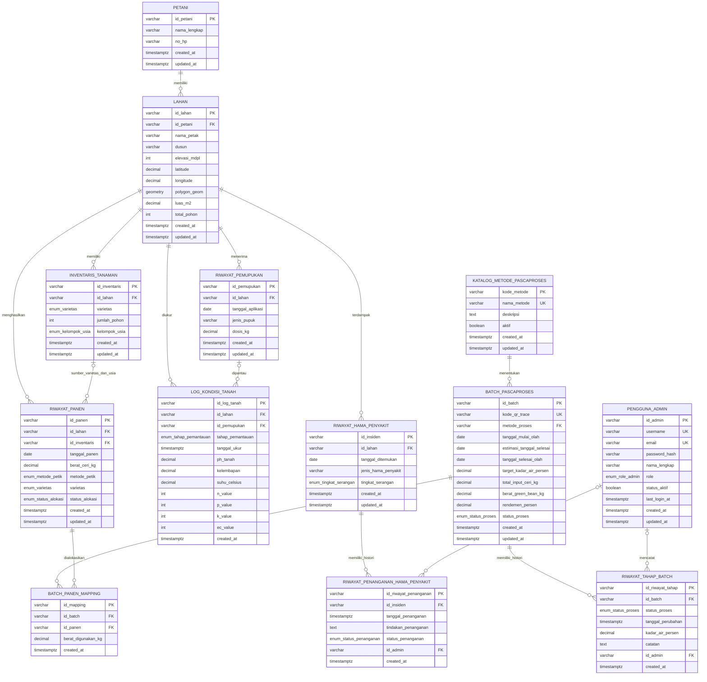
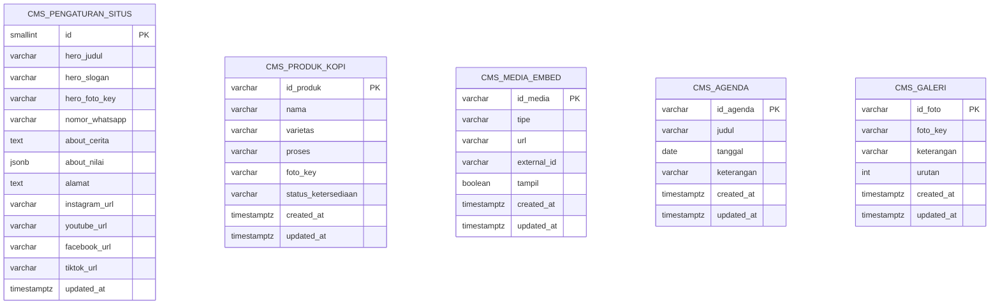

# Entity Relationship Diagram

ERD ini mengikuti schema hasil penerapan berurutan migration `000001`, `000002`
(seed data), `000003`, dan `000004`. Migration `000003` menambahkan hubungan
pengukuran tanah dengan pemupukan serta histori penanganan hama/penyakit;
`000004` menambahkan katalog metode pascaproses, alokasi panen yang terlacak,
target batch, dan histori tahapan pengolahan.

## Catatan relasi dan histori

- `LOG_KONDISI_TANAH.id_pemupukan` dan `tahap_pemantauan` harus sama-sama
  kosong untuk pengukuran umum, atau sama-sama berisi untuk monitoring
  `SEBELUM`/`SESUDAH`.
- Foreign key komposit `(id_pemupukan, id_lahan)` memastikan pengukuran hanya
  dapat dikaitkan dengan aplikasi pemupukan pada lahan yang sama.
- Log pemantauan membatasi penghapusan aplikasi pemupukan yang masih dirujuk.
  Penghapusan lahan tetap menghapus data turunannya sesuai foreign key lahan.
- Setiap perubahan penanganan disimpan sebagai baris baru. Status terkini
  ditentukan dari catatan dengan `tanggal_penanganan` terbaru, lalu
  `id_riwayat_penanganan` sebagai pemecah seri yang deterministik.
- `id_admin` pada catatan penanganan bersifat opsional. Menghapus akun admin
  mempertahankan catatan dan mengosongkan referensi admin.
- Migration `000003` membentuk satu catatan baseline dari nilai tindakan/status
  lama untuk setiap insiden. Waktu baseline memakai `updated_at` lama sebagai
  waktu terakhir yang diketahui; histori perubahan sebelumnya tidak dapat
  dipulihkan dari schema lama.
- Rollback `000003` memulihkan tindakan/status terbaru ke tabel insiden dan
  menghapus tabel histori baru. Catatan tambahan yang dibuat setelah migration
  tidak dapat dipertahankan dalam schema lama.
- Migration `000004` menambahkan katalog metode pascaproses dinamis dan
  memigrasikan nilai enum lama menjadi baris katalog. `metode_proses` pada
  batch menyimpan `kode_metode` yang menjadi foreign key.
- `riwayat_panen.id_inventaris` nullable untuk menjaga kompatibilitas data
  panen lama. Panen baru di API wajib menunjuk inventaris sehingga varietas dan
  kelompok usia bisa ditelusuri ke batch.
- `riwayat_tahap_batch` menyimpan setiap perubahan status dan pengukuran kadar
  air. Status pada batch merupakan status terkini yang disinkronkan dari event
  tahap terbaru.
- Total alokasi satu panen tidak boleh melebihi berat panen. Trigger menjaga
  `status_alokasi` dan `total_input_ceri_kg` tetap sinkron terhadap mapping.
  Berat green bean dan rendemen dihitung serta dibatasi saat hasil akhir dicatat.
- Rollback `000004` akan membuang katalog metode, histori tahap batch, target
  proses, tautan inventaris panen, dan aturan alokasi baru; backup sebelum
  rollback tetap disarankan.

## Schema Community Profile & CMS (`000006`)

Migration `000006` menambahkan tabel independen untuk mengelola publikasi profil kelompok tani dan katalog pameran kopi publik:

